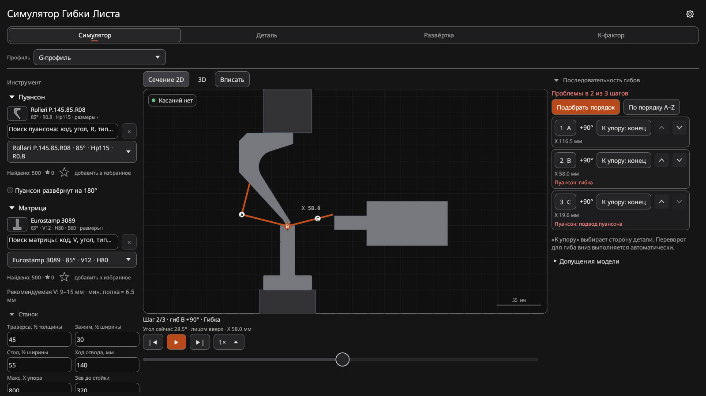
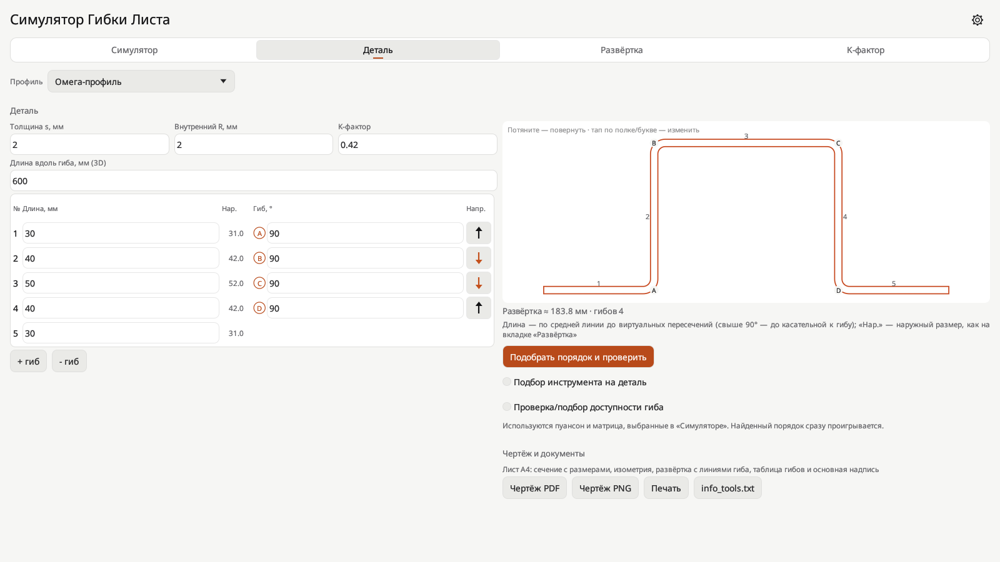
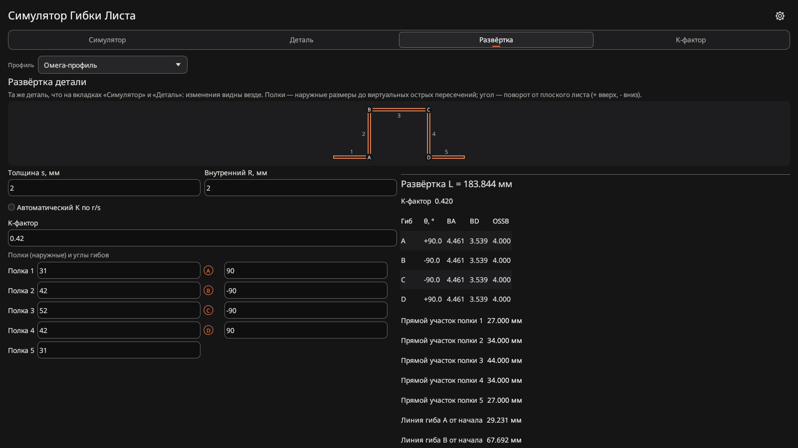
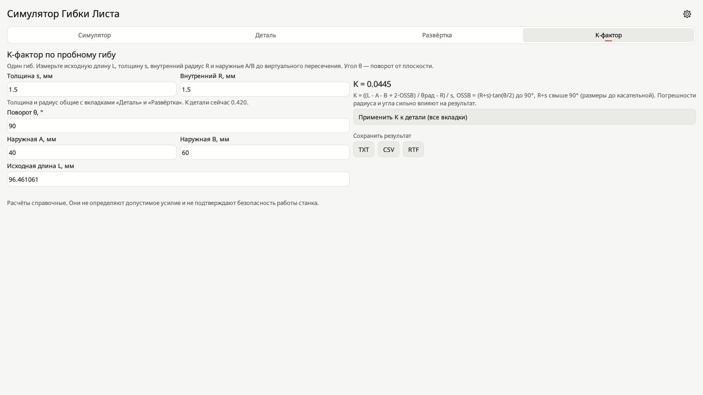

# Симулятор Гибки Листа — Windows

Офлайн-симулятор листогибочного пресса: деталь, пуансоны и матрицы, последовательность гибов, 2D/3D-визуализация, развёртка, K-фактор и чертежи.

### [⬇️ Скачать Windows-версию](../../releases/latest)

Это отдельный репозиторий Windows-версии. [Версия для Android](https://github.com/frikks/gibgib-sim). Исходный код публично не размещается.

## Файлы и совместимость

| Файл | Назначение |
|---|---|
| `GibGib-Sim-3.3.0-Windows-x64.exe` | Запуск без установки, 64-битные Windows 10 и 11. EXE не подписан. |
| `GibGib-Sim-3.3.0-Windows11-x64-TEST.msix` | Тестовый установочный пакет для Windows 11 x64; требуется сертификат ниже. |
| `GibGib-Sim-Windows-TEST-2026.cer` | Открытый тестовый сертификат для MSIX. |

Предыдущий EXE и MSIX проверены пользователем на Windows 11 Pro 26H1, сборка 28000.2704. Версия 3.3.0 собрана и проверена визуально на Linux (широкое окно 1600×900) и 38 автотестами, но **её запуск на Windows ещё не подтверждён**. Windows 7/8, 32-битная и ARM Windows не поддерживаются этой сборкой.

## Установка MSIX

Пакет подписан **самоподписанным тестовым сертификатом**, а не сертификатом проверенного издателя. Его установка требует добавления сертификата в доверенные на компьютере. Доверяйте ему только если понимаете этот риск; сертификат может использоваться для доверия и другим пакетам, подписанным тем же ключом. Для тестирования проще выбрать EXE, который не требует установки сертификата.

1. Скачайте MSIX и CER в одну папку.
2. Проверьте SHA-256 CER: `404BC3395192697C78C3C9D32D41AEF8920C52A4F01CA898EEC7E5812D7364F4`.
3. Откройте PowerShell **от имени администратора** в папке с файлами и выполните:

```powershell
Import-Certificate -CertStoreLocation "Cert:\LocalMachine\TrustedPeople" -FilePath ".\GibGib-Sim-Windows-TEST-2026.cer"
Add-AppxPackage ".\GibGib-Sim-3.3.0-Windows11-x64-TEST.msix"
```

Пакет 3.3.0 подписан тем же тестовым сертификатом, что и 3.2.1, поэтому должен ставиться поверх 3.2.1 (обновление поверх 3.2.0 с другим сертификатом не проверялось). При проблемах сначала сохраните данные и проверьте сообщение Windows; не удаляйте старую версию без резервной копии данных. После тестирования доверие можно отозвать, удалив сертификат с отпечатком SHA-1 `AFAE91781197A5135DBE4F51FD05E02ED8C93044` из «Доверенные пользователи» локального компьютера.

## Что нового в 3.3.0
- Новый внешний вид, как в Android 3.3.0: графитовые темы (светлая, тёмная, AMOLED), один акцент — сигнальный оранжевый, вкладки одной строкой, буквы гибов в кружках, стальной серый инструмент и размеры как линии чертежа.
- Широкое окно по-прежнему раскладывает «Деталь», «Развёртку» и «K-фактор» в две колонки.
- Расчёты, библиотека и чертёж не менялись. Редизайн — по методике [unslop](https://github.com/heydamir/unslop).

## Возможности

- 2D/3D-симуляция и подбор последовательности; библиотека из 500 пуансонов и 500 матриц, избранное.
- Вкладки «Деталь», «Развёртка» и «K-фактор» адаптируются к ширине окна: на широких экранах используют две колонки, в узких окнах — вертикальную прокрутку.
- Экспорт чертежей PDF/PNG, информации об инструменте и отчётов TXT/CSV/RTF. На Windows кнопка «Печать» создаёт PDF для печати в другой программе.
- Параметры сохраняются локально в `%LOCALAPPDATA%\GibGib-Sim`; файлы экспорта — в `Documents\GibGib-Sim` профиля пользователя (при недоступности папки — в текущей папке). Для установленного MSIX Windows может перенаправлять пути в контейнер пакета.
- Русский и английский языки, темы оформления; вибрация в Windows не используется.

## Экраны

*Настольная проверка в Linux; внешний вид Windows может отличаться.*






## Важно

Расчёты справочные: приложение не управляет станком и не подтверждает безопасность гибки. Всегда проверяйте инструмент и последовательность по документации оборудования.

© 2026 [@Frikks](https://t.me/Frikks). Все права защищены. Условия использования — [LICENSE](LICENSE). Лицензии сторонних компонентов — [THIRD-PARTY-LICENSES.txt](THIRD-PARTY-LICENSES.txt).
